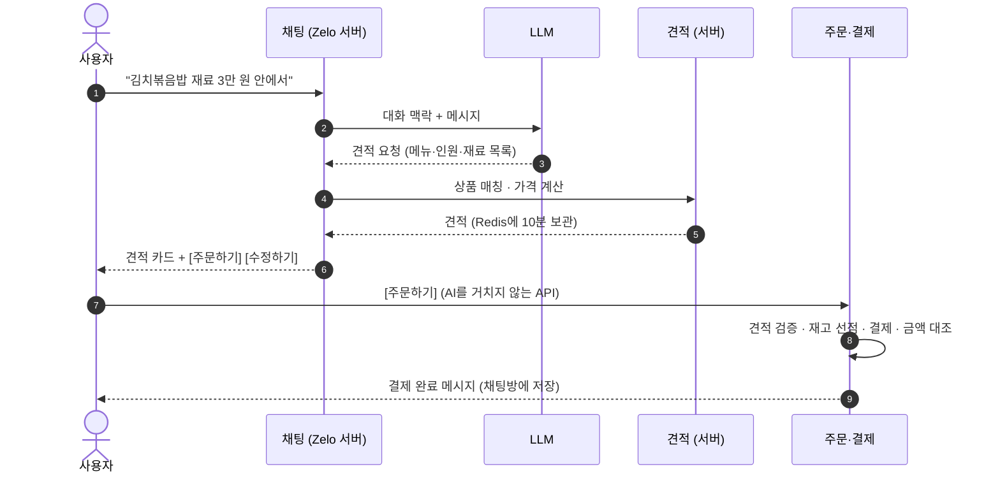
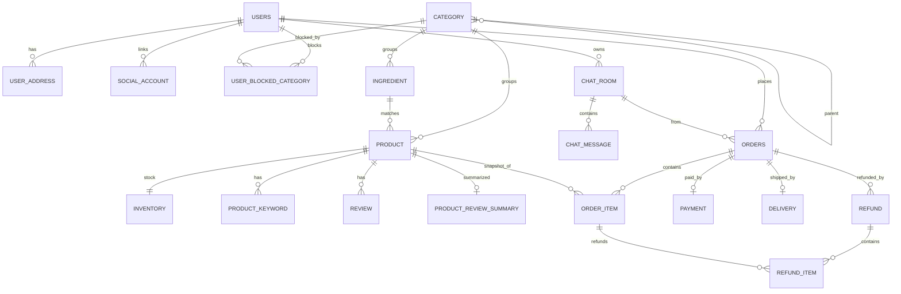
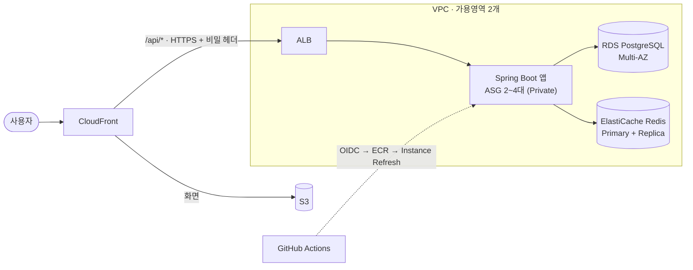

<div align="center">

# 🛒 Zelo

### 제로클릭(Zero-Click) 커머스

**말하면 장바구니가 차고, `주문하기` 한 번이면 결제까지.**

AI 채팅으로 상품 추천부터 견적·주문·결제까지 처리하는 커머스 플랫폼

<br>


[**📖 Wiki**](https://github.com/spa-2/zelo/wiki) · [부하테스트 결과](https://github.com/spa-2/zelo/wiki/부하테스트-결과-및-성능-개선) · [인증·인가](https://github.com/spa-2/zelo/wiki/인증.인가) · [AWS 인프라](https://github.com/spa-2/zelo/wiki/AWS-인프라-구성)

<br>

[](https://youtu.be/hSEMOnHOh8Q)

▶ 이미지를 누르면 시연 영상(YouTube)으로 이동합니다.

</div>

<br>

## 🔎 이런 서비스예요

> **사용자 -**  토요일 저녁에 초등학생 둘이랑 넷이 먹을 김치볶음밥 재료, 3만 원 안에서 준비해 줘
>
> **Zelo -**  아이들이 먹기 좋게 맵지 않은 백김치로 골랐어요. 7개 품목, 합계 28,400원이에요. 이대로 주문할까요?
> `[ 주문하기 ]` `[ 수정하기 ]`
>
> **사용자 -**  쌀은 집에 있어. 빼 줘
>
> **Zelo -**  쌀을 빼고 다시 담았어요. 6개 품목, 합계 21,900원이에요.

<sub>위 대화의 품목과 금액은 예시입니다.</sub>

메뉴를 고르고, 재료를 정하고, 상품을 비교하고, 장바구니에 담는 일을 AI가 대신합니다. 사용자는 **`주문하기`** 를 한 번 누르면 주문·결제·배송 접수까지 끝납니다.

AI가 대신 장을 보면 **"AI가 가격을 틀리면? 두 번 결제되면? AI가 멈추면?"** 이라는 질문이 생깁니다. Zelo는 *AI가 틀리거나 멈춰도 돈과 재고는 안전한 서버*를 목표로 설계했고, 그 주장을 부하 테스트와 장애 복구 테스트로 직접 측정해 확인했습니다.

### 핵심 성과

| 항목 | 적용 전 | 적용 후 |
|---|---|---|
| 상품 검색 부하 p95 | `2.78 s` | `45 ms` · 검색 개선 (#399) |
| 견적 발급 p95 / 처리 한계 | `995 ms` / 초당 약 `7.5`건 | `325 ms` / 초당 약 `26`건 · 후보 쿼리 개선 (#411) |
| 재고 10개 · 동시 주문 30명 | (적용 전 측정은 하지 않음) | `10명` 성공 · 가용 재고 `0` · DB 비관적 락 |
| LLM 응답 장애 | (설정상 요청마다 최대 24.5초 대기, 서킷 없이는 스레드 고갈 우려) | `12.8초` 만에 서킷 open, 실패 안내 평균 `0.03초`, 복구 뒤 `13.2초` 만에 자동 close |
| AWS 통합 부하 (DAU 5만 가정, 20분) | 결제 p95 `2.76 s` (RDS `db.t4g.micro`) | 결제 p95 `945 ms` (`db.m7g.large`) · HTTP 실패 `0%` · 구매 1,113건 전부 결제 완료 |
| AWS 재결제 | JVM 시간대(UTC) 문제로 실패율 `7.60%` | 실행 이미지에 시간대 적용 후 `0%` |
| RDS·Redis 장애 전환 (운영) | 락 누수로 배송지 API가 **영구** 409 | 락 유효 시간 60초 지정 → **최대 60초**, 쓰기 유실 `0건` |

<sub>p95: 요청 100개 중 95개가 이 시간 안에 끝남 · 서킷(Circuit Breaker): 외부 서비스가 계속 실패하면 호출을 잠시 끊어 장애가 번지지 않게 하는 장치 · 비관적 락: 같은 데이터를 한 번에 하나씩만 바꾸게 DB에서 잠그는 방식</sub>

---

## 목차

1. [프로젝트 소개](#1-프로젝트-소개) · 2. [기술 스택](#2-기술-스택) · 3. [핵심 흐름](#3-핵심-흐름) · 4. [주요 기능](#4-주요-기능) · 5. [ERD](#5-erd) · 6. [인프라](#6-인프라-아키텍처)
7. [핵심 설계](#7-핵심-설계) · 8. [테스트 및 검증](#8-테스트-및-검증) · 9. [협업 방식](#9-협업-방식) · 10. [팀 구성](#10-팀-구성-rr) · 11. [실행 방법](#11-실행-방법) · 12. [문서](#12-문서)

---

## 1. 프로젝트 소개

| 항목 | 내용 |
|---|---|
| 프로젝트 | Zelo — AI 채팅 기반 제로클릭 커머스 플랫폼 |
| 기간 | 2026.10 ~ 2026.11 |
| 인원 | 4명 |
| 배포 | AWS (CloudFront + S3 / ALB + EC2 Auto Scaling / RDS / ElastiCache) |

장보기는 "무엇을 만들지 → 재료가 뭔지 → 어떤 상품이 좋은지 → 얼마인지"를 매번 직접 고르고 비교해야 합니다. Zelo는 이 과정을 대화 한 번으로 줄입니다. 다만 AI에게 돈과 재고를 맡길 수는 없으므로, **AI는 말만 하고 계산·결제·재고는 서버가 책임지는 구조**로 만들었습니다.

**목표**

- 대화로 메뉴·재료·예산을 받아 상품이 담긴 견적 만들기 (수정·대체·예산 조정 포함)
- `주문하기` 한 번으로 주문 → 재고 선점 → 결제(포트원) → 배송 접수
- 두 번 눌러도 주문 1건, 동시에 사도 재고 정확, 외부 서비스(LLM·결제사)가 멈춰도 서비스 유지
- 가용영역 2개에 이중화한 AWS 운영 환경(Terraform), DAU 5만 가정 부하 테스트와 운영 장애 복구 테스트

---

## 2. 기술 스택

| 구분 | 기술 |
|---|---|
| Backend | Java 21, Spring Boot 4.1, Spring Security, Spring Data JPA, QueryDSL |
| AI | Spring AI 2.0 (OpenAI), Resilience4j (CircuitBreaker · Retry · TimeLimiter) |
| Data | PostgreSQL 16, Flyway, Redis 7, Redisson (분산락) |
| Auth · Payment · Mail | JWT, BCrypt, Google·Kakao OAuth2 · PortOne · AWS SES |
| Infra | AWS (CloudFront, S3, ALB, EC2 ASG, RDS Multi-AZ, ElastiCache, ECR, SSM), Terraform |
| CI/CD · 관측 | GitHub Actions(OIDC), Docker, Prometheus, Grafana, Loki, CloudWatch |
| Test | JUnit 5, Mockito, k6, SonarCloud |

---

## 3. 핵심 흐름



- **LLM은 "재료 목록"만** 만듭니다. 상품 매칭, 가격, 재고, 합계는 서버가 계산합니다.
- **주문은 AI를 거치지 않는 일반 API**로만 진행합니다.
- 재고는 **실재고 · 선점 · 가용** 세 숫자로 관리합니다. 주문하면 선점하고, 결제되면 차감하고, 취소·만료되면 해제합니다.
- 결제 결과는 프론트 확인 요청, 포트원 웹훅, 대사 스케줄러 세 곳에서 동시에 들어올 수 있어서, **결제 번호 단위 락 + 상태 전이**로 포트원 조회와 재고 차감이 한 번만 일어나게 했습니다.

---

## 4. 주요 기능

| 도메인 | 기능 |
|---|---|
| 회원 · 인증 | 이메일 가입(6자리 코드 인증), 로그인, 토큰 재발급, 비밀번호 재설정, Google·Kakao 소셜 로그인, 배송지, 제한 카테고리 |
| 상품 | 검색, 자동완성, 인기 검색어·인기 상품, 상세, 관리자 상품 등록·수정·판매 중지·입고 |
| 채팅 · AI | 채팅방, 메시지, 실패 메시지 재시도, 견적 품목 수정·대체 상품·예산 옵션, 리뷰 요약 |
| 견적 | 메뉴 계획 → 재료 → 상품 매칭 → 가격·재고 계산, 제한 품목 자동 제외 |
| 주문 · 재고 | 견적 기반 주문(멱등), 결제 전 취소, 미결제 주문 자동 만료, 재고 선점·차감·해제 |
| 결제 · 환불 · 배송 | 포트원 결제 확정(서버 재검증), 저장 결제수단 재결제, 웹훅, 전액·부분 환불, 배송 접수 |

API 호출 예시는 [`http/zelo-scenario.http`](http/zelo-scenario.http)에 있습니다.

---

## 5. ERD

> 핵심 테이블 요약입니다. 결제·배송·환불은 주문 ID로 논리적으로 연결됩니다. 전체 스키마는 `src/main/resources/db/migration/V1__baseline.sql`을 봅니다.



**테이블이 아닌 저장소 (Redis)**: 견적(10분), refresh 토큰, 이메일 인증 코드·소셜 가입 티켓, 발송·로그인 시도 제한, 분산락, 상품 조회 캐시.

---

## 6. 인프라 아키텍처



- **진입점은 CloudFront 하나**입니다. ALB는 CloudFront만 아는 비밀 헤더가 없는 직접 요청을 403으로 막습니다.
- **가용영역 2개에 이중화**했습니다. 앱은 Private 서브넷의 Auto Scaling Group, DB는 RDS Multi-AZ, Redis는 복제본을 두어 한쪽이 죽어도 자동으로 전환됩니다.
- **시크릿은 SSM**에 두고, 배포는 GitHub Actions가 OIDC로 로그인하므로 AWS 액세스 키를 저장하지 않습니다.
- **dev(부하 테스트)와 prod(운영)를 분리**했고 Terraform workspace로 상태를 따로 관리합니다.
- 로그·알람은 CloudWatch, 지표는 Prometheus + Grafana로 보고, 알람은 Slack으로 전달합니다.

자세한 구성은 [Wiki · AWS 인프라 구성](https://github.com/spa-2/zelo/wiki/AWS-인프라-구성), 선택 이유는 [AWS 인프라 선택 근거](https://github.com/spa-2/zelo/wiki/aws-인프라)에 있습니다.

---

## 7. 핵심 설계

| | 원칙 | 어떻게 지키나 | |
|:---:|---|---|:---:|
| 🧾 | **AI는 말하고, 계산은 서버가** | LLM은 재료 목록만 만들고, 상품 매칭·가격·재고·합계는 서버가 계산합니다. | |
| ✅ | **`주문하기`를 눌러야만, 결제는 한 번만** | 견적 번호를 주문 키로 쓰고 사용자 락과 `quote_id` UNIQUE로 세 겹 방어해, 두 번 눌러도 주문은 1건입니다. | [자세히](https://github.com/spa-2/zelo/wiki/주문-결제-멱등성) |
| 📦 | **동시에 사도 재고는 정확하게** | 재고 행을 비관적 락으로 잠그고, 여러 상품은 ID 오름차순으로 잠가 교착을 막습니다. | [자세히](https://github.com/spa-2/zelo/wiki/재고-동시성) |
| 🛡️ | **AI가 멈춰도 서비스는 산다** | 시도당 12초 제한, 재시도 1회, 서킷 브레이커. 실패해도 사용자 메시지는 남고 고정 문구로 답합니다. | [결과](docs/load-test/chat-outage-test-result.md) |
| 🚫 | **AI가 사면 안 되는 건 안 산다** | 주류 같은 제한 품목은 견적에서 자동으로 빠집니다. | |

**공통 설계**

- **분산락**: `LockDistributeService` 한 곳에서만 Redisson 락을 쓰고, Facade가 락으로 Command 호출 전체를 감싸 트랜잭션 커밋 뒤에 락이 풀립니다. 락 유효 시간(60초)은 운영 장애 테스트에서 락이 영구히 남는 문제를 발견해 추가했습니다.
- **계층 분리**: Controller → (Facade: 락) → (Command: 트랜잭션 조율) → Service → Repository. 락·조율이 필요 없으면 해당 계층을 건너뜁니다.
- **관측성**: 예외 로그와 실패 횟수는 `GlobalExceptionHandler` 한 곳에서만 남기고, 모든 에러 코드를 지표로 집계합니다. ([로깅·지표 가이드](docs/logging-metrics-guide.md))

---

## 8. 테스트 및 검증

목표는 DAU 5만(가정)의 피크 1시간 1만 명 × 안전계수 1.5입니다. OpenAI·포트원·소셜 로그인은 fake로 대체하고 지연은 실측값을 썼습니다.

| 검증 | 결과 | 상세 |
|---|---|---|
| 동시성 단위 테스트 | 재고 10개에 30명 동시 주문 → 성공 10, 실패 20, 가용 0 | `InventoryConcurrencyTest` |
| 도메인별 부하 테스트 (k6) | 인증·상품·채팅·주문·결제·환불 모두 목표 통과, AWS에서 실패 0% | [Wiki · 부하테스트](https://github.com/spa-2/zelo/wiki/부하테스트-결과-및-성능-개선) |
| AWS 통합 부하 (20분) | RDS 사양 상향 전후 비교로 결제·쓰기·자동완성 응답 시간 기준 통과 | [Wiki · 부하테스트](https://github.com/spa-2/zelo/wiki/부하테스트-결과-및-성능-개선) |
| LLM 장애·복구 | 모든 호출이 15초 지연되는 상황에서 1,485건 실패 0%, 12.8초 만에 서킷 open | [결과서](docs/load-test/chat-outage-test-result.md) |
| 운영 장애 복구 (RDS·Redis) | 자동 전환, 확인 응답을 받은 쓰기 유실 0건, 분산락 누수 발견·개선 | [보고서](docs/failover-test/REPORT.md) |

**부하 테스트에서 알게 된 것**

- 외부 응답을 기다리는 API(소셜 로그인·채팅·결제·환불)는 기다리는 동안 요청 스레드를 잡아 **Tomcat 스레드 200개가 먼저 찼습니다.**
- 병목을 고치면 다음 병목으로 **이동**했습니다. 견적 쿼리를 고친 뒤 채팅의 한계가 메시지 약 3.8 → 20 RPS로 올랐고, 막히는 곳이 DB 커넥션에서 Tomcat 스레드로 바뀌었습니다.
- 로컬 측정은 앱·DB·k6가 PC 한 대를 나눠 써 수치가 흔들려서, k6를 앱과 다른 서버에 두고 AWS에서 다시 쟀습니다.

**남은 과제**

- 포트원 응답이 느려지면 스레드가 고갈돼 무관한 API까지 느려집니다(상품 조회 39ms → 1.75s). 동시 호출 제한과 서킷 브레이커를 개선안으로 정했지만 아직 적용하지 않았습니다. ([결과](docs/load-test/payment-portone-delay-test-result.md))
- 분산락이 새는 근본 원인은 못 찾았고, 영향 시간만 영구 → 60초로 줄였습니다.
- 장애 시험은 계획된 failover만 했고 AZ 전체 장애는 시험하지 않았습니다.

---

## 9. 협업 방식

- **Git**: 이슈 기반 브랜치(`feat/#이슈번호-설명`), `main` 직접 커밋 금지, PR 머지. 커밋은 `type: 제목`, 한 커밋에 한 목적
- **리뷰**: 팀원 리뷰 + CodeRabbit 자동 리뷰(`@Valid` 누락, 트랜잭션 경계, N+1, 경쟁 조건 등 점검)
- **CI/CD**: PR마다 테스트 + SonarCloud, `dev`/`main` 머지 시 테스트 통과 후 이미지 빌드·인스턴스 교체 배포
- **컨벤션**: 계층 책임·트랜잭션·락·네이밍·로깅 기준을 [`AGENTS.md`](AGENTS.md)에 문서화

---

## 10. 팀 구성 (R&R)

| 이름 | 담당 | 주요 기여 |
|---|---|---|
| **신원열** | 인증·인가, 인프라, 공통 | JWT 인증·소셜 로그인·이메일 인증, AWS 인프라(Terraform)·CI/CD·모니터링, Flyway, 공통 분산락·예외·지표 |
| **강승규** | 결제, 환불, 배송 | 포트원 결제·웹훅·환불, 배송 |
| **최정이** | 상품, 견적 | 상품·재료·카테고리, 상품 매칭, 견적 발급 |
| **정유림** | LLM, 채팅, 리뷰 | 채팅, LLM 연동·장애 대응, 견적 요청, 리뷰 요약 |

---

## 11. 실행 방법

Java 21과 Docker가 필요합니다.

```bash
docker compose up -d --wait        # Postgres 16, Redis 7
export OPENAI_API_KEY=dummy        # 없으면 기동 실패 (LLM_MODE=fake면 호출하지 않음)
export JWT_SECRET=<Base64, 32바이트 이상>
./gradlew bootRun
```

로컬 기본값은 LLM·소셜 로그인·메일이 모두 `fake`라 API 키 없이 전체 흐름을 돌려볼 수 있습니다. 실제 연동은 `LLM_MODE` · `SOCIAL_MODE` · `MAIL_MODE`를 `real`로 바꿉니다. (`SOCIAL_MODE=fake`는 운영에서 쓰지 않습니다.)

```bash
./gradlew test                     # Postgres·Redis 필요
```

부하 테스트는 [`load-test/README.md`](load-test/README.md), 인프라 배포는 [`terraform/README.md`](terraform/README.md)를 봅니다.

---

## 12. 문서

| 문서 | 내용 |
|---|---|
| [인증·인가 기술 선택](https://github.com/spa-2/zelo/wiki/인증.인가) | JWT, refresh 로테이션, 로그인·메일 제한, 소셜 로그인 |
| [주문·결제 멱등성](https://github.com/spa-2/zelo/wiki/주문-결제-멱등성) · [재고 동시성](https://github.com/spa-2/zelo/wiki/재고-동시성) | 중복 주문 방지, 재고 정합성 |
| [부하테스트 결과 · 성능 개선](https://github.com/spa-2/zelo/wiki/부하테스트-결과-및-성능-개선) | 목표 계산, 도메인별 결과, 병목 분석 |
| [장애 복구 테스트](docs/failover-test/REPORT.md) | RDS·Redis failover 측정, 발견한 문제와 개선 |
| [AWS 인프라 구성](https://github.com/spa-2/zelo/wiki/AWS-인프라-구성) · [선택 근거](https://github.com/spa-2/zelo/wiki/aws-인프라) · [Terraform](https://github.com/spa-2/zelo/wiki/테라폼-구성) | 인프라 구성도와 선택 이유 |
| 파트별 블로그 | [상품·견적](https://github.com/spa-2/zelo/wiki/상품-견적) · [재고·주문](https://github.com/spa-2/zelo/wiki/재고-주문) · [결제·배송](https://github.com/spa-2/zelo/wiki/결제-배송) · [AI·채팅·리뷰](https://github.com/spa-2/zelo/wiki/AI-채팅-리뷰) |
