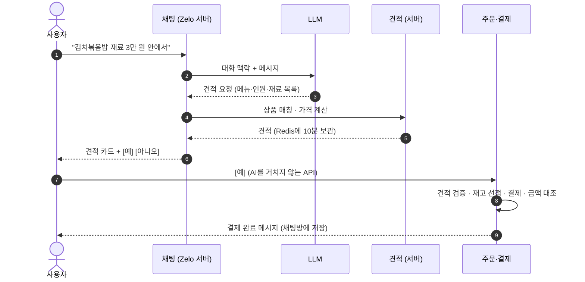

# Zelo

### 제로클릭(Zero-Click) 커머스

**말하면 장바구니가 차고, `예` 한 번이면 결제까지.**

AI 에이전트가 장보기를 대신합니다

 

[**📖 Wiki**](https://github.com/spa-2/zelo/wiki) · [서비스 시나리오](https://github.com/spa-2/zelo/wiki/서비스-시나리오) · [아키텍처](https://github.com/spa-2/zelo/wiki/아키텍처) · [API 명세](https://github.com/spa-2/zelo/wiki/API-명세)

 

## 🔎 이런 서비스예요

> **사용자 -**  토요일 저녁에 초등학생 둘이랑 넷이 먹을 김치볶음밥 재료, 3만 원 안에서 준비해 줘
>
> **Zelo -**  아이들이 먹기 좋게 맵지 않은 백김치로 골랐어요. 7개 품목, 합계 28,400원이에요. 이대로 주문할까요?
> `[ 예 ]` `[ 아니오 ]`
>
> **사용자 -**  쌀은 집에 있어. 빼 줘
>
> **Zelo -**  쌀을 빼고 다시 담았어요. 6개 품목, 합계 21,900원이에요.

위 대화의 품목과 금액은 예시입니다.

메뉴를 고르고, 재료를 정하고, 상품을 비교하고, 장바구니에 담는 일을 AI가 대신합니다. 사용자는 **`예`** 를 한 번 누르면 주문·결제·배송 접수까지 끝납니다.

 

## 🤔 무엇이 다른가요

AI가 대신 장을 보면 이런 질문이 생깁니다. **AI가 가격을 틀리면? 두 번 결제되면? AI가 멈추면?**
Zelo는 *AI가 틀리거나 멈춰도 돈과 재고는 안전한 서버*를 목표로 설계했습니다.

| | 원칙 | 어떻게 지키나 | |
|:---:|---|---|:---:|
| 🧾 | **AI는 말하고, 계산은 서버가** | LLM은 "재료 목록(견적 요청)"만 만듭니다. 상품 매칭·가격·재고·합계는 서버가 계산합니다. | [자세히](https://github.com/spa-2/zelo/wiki/견적-생성) |
| ✅ | **`예`를 눌러야만, 결제는 한 번만** | 주문은 AI를 거치지 않는 일반 API로만 진행합니다. 멱등키, DB 유니크 제약, 조건부 상태 변경으로 두 번 눌러도 주문은 1건입니다. | [자세히](https://github.com/spa-2/zelo/wiki/주문-결제-멱등성) |
| 📦 | **동시에 사도 재고는 정확하게** | 재고 선점은 Redisson 분산 락으로 순서를 지켜 처리합니다. | [자세히](https://github.com/spa-2/zelo/wiki/재고-동시성) |
| 🛡️ | **AI가 멈춰도 서비스는 산다** | 시도당 시간 제한, 재시도 1회, 서킷 브레이커를 겁니다. 실패해도 사용자 메시지는 남고, 고정 문구로 답합니다. | [자세히](https://github.com/spa-2/zelo/wiki/LLM-장애-대응) |
| 🚫 | **AI가 사면 안 되는 건 안 산다** | 주류 같은 제한 품목은 견적에서 자동으로 빠집니다. | [자세히](https://github.com/spa-2/zelo/wiki/제한-품목) |

 

## 👀 한눈에 보는 흐름

> 시나리오 전체(가격 변동, 품절, 결제 실패, LLM 장애 등)는 [Wiki · 서비스 시나리오](https://github.com/spa-2/zelo/wiki/서비스-시나리오)에 있습니다.

 

## ⚒️ 기술 스택

| 분류 | 사용 기술 |
|---|---|
| **Language · Framework** |     |
| **AI** |    |
| **Data** |    |
| **Payment** |  |
| **Test · Quality** |    |
| **Build · Infra** |    |

 

## 👤 작업 파트

| 파트 | 맡은 일 |
|---|---|
| 회원 · 인프라 | 가입 · 로그인 · JWT, 공통 응답 · 에러 코드, Docker, CI/CD |
| 상품 · 견적 | 상품 · 재료 · 카테고리, 상품 매칭, 견적 발급 |
| 재고 · 주문 | 재고 선점 · 동시성, 주문 생성 · 상태 관리 |
| 결제 · 배송 | 포트원 결제, 웹훅, 환불, 배송 |
| AI · 채팅 · 리뷰 | 채팅, LLM 연동 · 장애 대응, 견적 요청, 리뷰 근거 |

 

## 🗂️ 문서

| 문서 | 내용 |
|---|---|
| [서비스 시나리오](https://github.com/spa-2/zelo/wiki/서비스-시나리오) | 기본 흐름, 수정 요청, 가격 변동 · 품절, 결제 실패 · 환불, LLM 장애 |
| [아키텍처](https://github.com/spa-2/zelo/wiki/아키텍처) | 도메인 구성, 계층별 책임, 트랜잭션 · 락 경계 |
| [ERD](https://github.com/spa-2/zelo/wiki/ERD) | 테이블 구조와 관계 |
| [API 명세](https://github.com/spa-2/zelo/wiki/API-명세) | 요청 · 응답 · 에러 코드 |
| [견적 생성](https://github.com/spa-2/zelo/wiki/견적-생성) | LLM 견적 요청 → 상품 매칭 → 가격 계산 |
| [주문 · 결제 멱등성](https://github.com/spa-2/zelo/wiki/주문-결제-멱등성) | 두 번 눌러도 한 번만 결제되는 이유 |
| [재고 동시성](https://github.com/spa-2/zelo/wiki/재고-동시성) | 분산 락과 재고 선점 |
| [LLM 장애 대응](https://github.com/spa-2/zelo/wiki/LLM-장애-대응) | 시간 제한 · 재시도 · 서킷 브레이커, 실패 응답 |
| [개발 컨벤션](https://github.com/spa-2/zelo/wiki/개발-컨벤션) | 브랜치 · 커밋 · 코드 규칙 |
| [트러블슈팅](https://github.com/spa-2/zelo/wiki/트러블슈팅) | 개발하며 만난 문제와 해결 |

