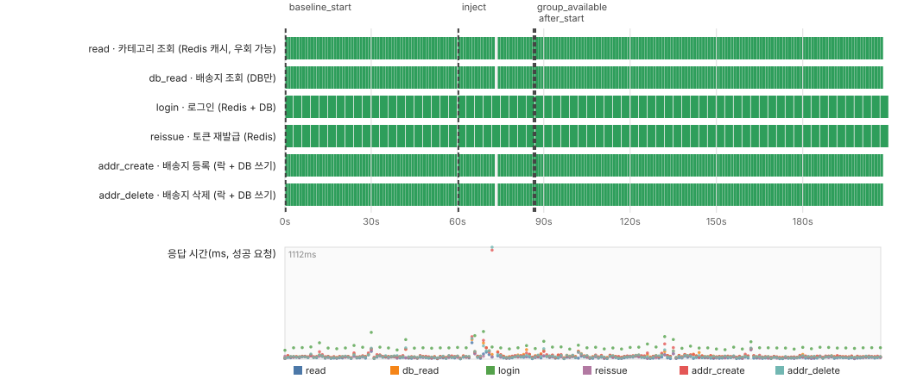
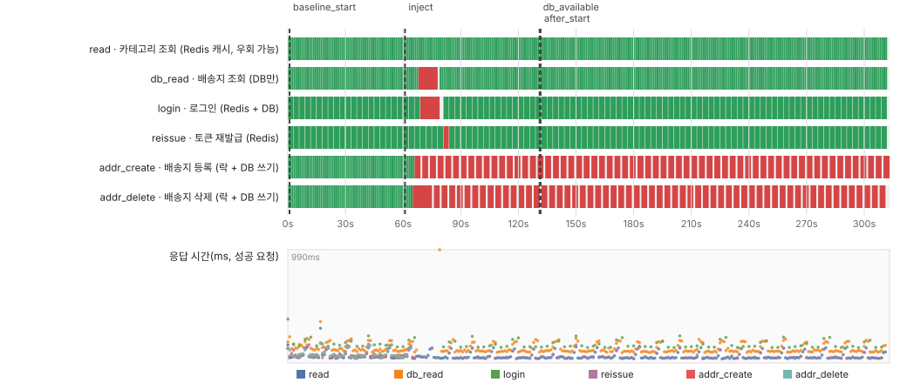
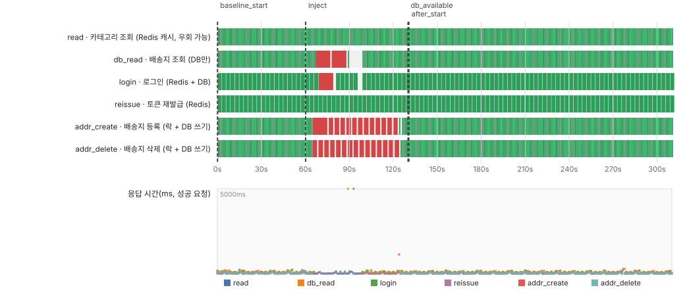
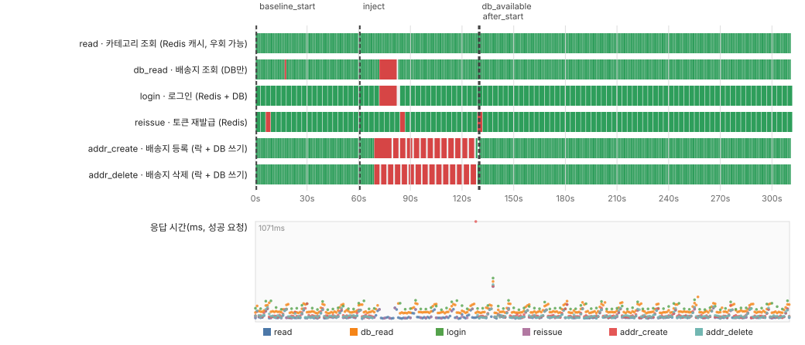

# 장애 복구 테스트 보고서 (RDS Multi-AZ, ElastiCache 복제본)

운영(prod) 환경에 이중화한 DB와 Redis가 장애 때 실제로 복구되는지, 복구되는 동안 서비스가 어떻게 동작하는지를 측정한 기록이다. 테스트일은 2026-11-12이다.

## 1. 요약

| 대상 | AWS 장애 전환 시간 | 사용자 요청 영향 | 쓰기 유실 |
|---|---|---|---|
| ElastiCache(Redis) | 약 20초 | 실패 0건, 1.1초 지연 2건 | 0건 |
| RDS(PostgreSQL) | 40~50초 (3회) | DB 읽기·로그인 약 20~30초 지연 또는 시간 초과 | 0건 |

- 두 이중화 모두 **자동으로 장애 전환**됐고 **확인 응답을 받은 쓰기는 하나도 사라지지 않았다.**
- 테스트에서 **앱의 문제를 하나 찾았다.** RDS 장애 전환 뒤 분산락이 풀리지 않아 배송지 같은 락 사용 API가 **영구히 막혔다.** 락에 유효 시간(60초)을 지정해서 **영구 → 최대 60초**로 줄였고, 같은 테스트를 2번 다시 돌려 확인했다.
- 앱이 새 서버를 늦게 찾아서 생기는 지연(DNS 캐시)은 **측정상 근거가 없어** 설정을 바꾸지 않았다.

## 2. 구성과 방법

- 앱: EC2 2대(ap-northeast-2c, 2a), 접속은 CloudFront → ALB → 앱
- RDS: `zelo-prod-postgres`, Multi-AZ(primary 2c, standby 2a)
- Redis: `zelo-prod-redis`, 복제 그룹, 자동 장애 전환과 Multi-AZ 사용(primary 2c, replica 2a), TLS
- 장애 일으키는 방법
  - Redis: `aws elasticache test-failover --replication-group-id zelo-prod-redis --node-group-id 0001`
  - RDS: `aws rds reboot-db-instance --db-instance-identifier zelo-prod-postgres --force-failover`
- 측정: 핵심 기능 6개를 1초 간격으로 계속 호출하고(`load-test/failover/probe.py`) 요청별 시각, 상태, 응답 시간을 기록했다. 기본 시드 데이터와 계정 하나로 돌아간다.

| 프로브 | 요청 | 의존 |
|---|---|---|
| `read` | `GET /api/categories` | Redis 캐시(장애 때 DB로 우회) |
| `db_read` | `GET /api/users/me/addresses` | DB만 |
| `login` | `POST /api/users/login` | Redis(리프레시 토큰) + DB |
| `reissue` | `POST /api/auth/reissue` | Redis |
| `addr_create`, `addr_delete` | 배송지 `POST`, `DELETE` | Redis 분산락 + DB 쓰기 |

- 실행 순서: 정상 상태 60초 → 장애 발생 → AWS가 끝났다고 할 때까지 대기 → 180초 더 기록 → 쓰기 유실 확인(`run.sh`)
- 쓰기 유실 확인: 201을 받은 배송지가 남아 있는지, 204를 받은 배송지가 사라졌는지 종료 시 조회한다.
- 시간 기준은 AWS가 남기는 이벤트(`aws-events.json`)이다. 프로브의 `t`는 요청을 보낸 시각이다.

## 3. Redis 장애 전환 (1회)

- AWS: 14:02:51 호출 → 14:03:11 완료(약 20초). primary가 `-001`(2c)에서 `-002`(2a)로 바뀌었다.
- 프로브 6개, 968건 **전부 성공**했다. 72초 부근에서 `addr_create`, `addr_delete`가 각각 1.1초 걸렸는데, Redis 명령 시간 제한(1초) 뒤 재시도로 성공한 것으로 보인다.
- 앱 로그에는 14:02:53부터 Redis 헬스체크 실패와 `Unable to acquire connection!`이 찍혔고, 14:03:22와 14:03:33에 연결 풀이 새 primary로 다시 만들어졌다.
- 해석: 앱은 연결을 잠시 잃었지만 사용자 요청은 실패하지 않았다. **왜 요청이 깨지지 않았는지는 확인하지 못했다**(재시도, 다른 연결 우회 등이 후보).
- 알림: 이 failover에서 Slack 알림은 오지 않았다. 현재 알람(5xx, CPU 등)은 failover 발생 자체를 감지하지 않는다.



## 4. RDS 장애 전환

### 4.1 수정 전 (1회): 락이 풀리지 않음

- AWS: 14:15:36 시작 → 14:16:26 완료(50초).
- `db_read`, `login`은 한 번씩 시간 초과로 실패했다가 돌아왔다.
- **그런데 배송지 등록, 삭제(`addr_create`, `addr_delete`)는 장애 직후부터 테스트가 끝날 때까지 계속 409**(락을 3초 기다리다 포기)였다. DB가 돌아온 뒤에도 풀리지 않았다.
- 테스트 후 Redis를 직접 조회했다. 락 키 `lock:user:address:2`가 남아 있었고 남은 시간(TTL)이 **줄지 않고 계속 30초 근처로 갱신**되고 있었다(29756ms, 29811ms). 소유자 스레드는 이미 요청을 끝내고 쉬고 있었다(스레드 덤프). 결국 약 26분 뒤 키를 수동으로 삭제해서 풀었다.
- 원인: 락 획득에 유효 시간이 없어 Redisson의 watchdog이 락을 계속 연장했다. 요청이 끝난 뒤에도 키가 남으면 연장이 이어진다. **왜 이 요청에서 unlock이 효과가 없었는지는 확인하지 못했다.**
- 증거: `results/20261112-141352-aws-rds/redis-lock-evidence.txt`



### 4.2 수정: 락 유효 시간 지정

- `LockDistributeService`에서 `tryLock(3, SECONDS)`를 `tryLock(3, 60, SECONDS)`로 바꿨다. watchdog이 꺼져서, 락이 새도 60초 뒤에 저절로 사라진다.
- Hikari `leak-detection-threshold: 20000`을 추가했다. 연결을 20초 넘게 쥔 스레드의 스택트레이스를 로그로 남긴다(다음 장애 때 원인 추적용).

### 4.3 수정 후 (2회)

| | 수정 전 | 수정 후 1 | 수정 후 2 |
|---|---|---|---|
| AWS failover | 14:15:36~14:16:26 (50초) | 07:55:38~07:56:23 (45초) | 08:07:13~08:07:53 (40초) |
| 배송지 API 409 구간 | 끝까지(수동 해제) | 65~123초 | 69~127초 |
| 락 키 남음 | 예 | 아니오 | (조회 안 함) |
| 쓰기 유실 | 확인 못 함(프로브 강제 종료) | 0건 | 0건 |

- 배송지 API는 두 번 모두 락을 잡은 시각 + 60초에 맞춰 복구됐다. 수정 후 1은 테스트 뒤 Redis에서 `KEYS lock:*`가 비어 있음을 확인했다.
- **락 누수 자체는 수정 후에도 2번 모두 다시 발생했다.** 줄인 것은 영향 시간(영구 → 약 60초)이다.
- DB 읽기와 로그인: 수정 후 1은 `db_read`가 67초에 시간 초과(10초), 78초에 시간 초과, 89초에 보낸 요청이 9.3초 뒤 성공했고 99초부터 정상이었다. 수정 후 2는 `db_read`, `login`이 72~82초 실패 후 돌아왔다. 사용자 입장에서 DB가 막힌 시간은 대략 **20~30초**로, AWS failover 시간(40~50초)보다 짧았다.
- `read`(Redis 캐시)는 모든 실행에서 100%였다. Redis만 쓰는 경로는 RDS 장애의 영향을 받지 않았다.





## 5. 이중화는 무엇을 해 주었나

- 둘 다 사람이 개입하지 않아도 자동으로 새 서버로 넘어갔고, 확인 응답을 받은 쓰기는 하나도 사라지지 않았다(유실 0건).
- Redis는 사용자 요청이 실패하지 않았다. RDS는 20~30초 동안 DB를 쓰는 요청이 지연되거나 실패했지만 **수 분 이상의 중단 없이** 돌아왔다.
- 이중화가 없는 구성과 직접 비교 측정은 하지 않았다. 이중화 없이는 장애 때 자동 대체가 없다는 구조적 차이가 근거다.
- 로컬 실행(컨테이너를 멈췄다가 15초 뒤 다시 켬)은 대체 서버가 없는 상황의 예시다. 멈춘 시간은 우리가 정한 값이라 복구 시간 비교 수치로는 쓰지 않았다.
- 이중화가 있어도 **앱이 장애를 견디는 방식**(이번의 분산락 누수)이 서비스 영향을 키울 수 있다는 점을 확인했다.

## 6. 한계

- 프로브는 내 PC에서 CloudFront를 거쳐 호출하므로 네트워크 흔들림(예: 일부 `URLError`)이 섞일 수 있다. 장애 구간과 무관한 것은 결과로 세지 않았다.
- 요청이 시간 초과까지 매달리는 동안 같은 프로브의 다음 호출을 건너뛰어서 실패 **건수**는 실제보다 적게 잡힌다. 실패 **구간**을 기준으로 봤다.
- 횟수가 적다(Redis 1회, RDS 수정 전 1회, 수정 후 2회). 평균이나 분포를 말할 수 없다.
- API로 일으킨 계획된 장애 전환이다. AZ 전체 장애나 동시 장애는 하지 않았다.

## 7. 개선과 남은 과제

| 항목 | 상태 |
|---|---|
| 분산락 유효 시간 60초 지정 | 적용, 2회 검증 |
| Hikari 연결 누수 감지(20초) | 적용 |
| 락이 새는 근본 원인 규명 | 미해결 |
| DB 장애 때 요청이 매달리는 시간(20~30초) 단축: pgjdbc `socketTimeout`, Hikari `connectionTimeout` | 후보, 미적용 |
| failover 알림(RDS 이벤트 구독, ElastiCache 알림을 SNS로) | 후보, 현재 알림 없음 |
| RDS failover 구간에 `reissue`가 401이 되는 경우(2회 관찰) | 원인 미확인 |
| JVM DNS 캐시(`networkaddress.cache.ttl`) 단축 | 검토 후 보류: Redis는 요청이 깨지지 않았고, RDS 읽기는 AWS 완료보다 먼저 돌아와서 DNS 때문에 늦어진 근거가 없다 |

## 8. 재현 방법과 원본

```bash
export BASE_URL=https://zelo.wyshin.click PROBE_EMAIL=<계정> PROBE_PASSWORD='<비밀번호>'
load-test/failover/run.sh aws redis --baseline 60 --after 120
load-test/failover/run.sh aws rds   --baseline 60 --after 180
```

사용법은 `load-test/failover/README.md`를 본다. 결과 폴더(`results/`)에는 `probe.csv`, `events.csv`, `verify.json`, AWS 이벤트 JSON, `report.html`, `timeline.svg`가 있다. 계정 ID는 지웠다.

| 폴더 | 내용 |
|---|---|
| `20261112-140143-aws-redis` | Redis 장애 전환 |
| `20261112-141352-aws-rds` | RDS, 수정 전 |
| `20261112-165351-aws-rds`, `20261112-170527-aws-rds` | RDS, 수정 후 |
| `20261112-125407-local-rds`, `20261112-125608-local-redis` | 로컬에서 도구를 검증한 실행(컨테이너를 껐다 켬) |
