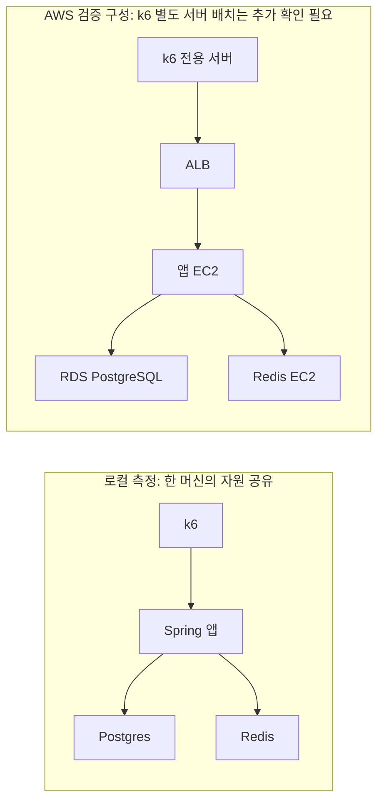

# 로컬 측정에서 AWS 검증으로: ZELO의 부하 테스트 환경 선택 근거

작성 기준: 2026-11-06 저장소의 측정 보고서와 코드. **로컬 실측, 코드로 확인한 AWS 설계, AWS에서 확인해야 할 결과를 구분한다.** 현재 확인한 자료에는 AWS 전후 비교 측정값과 k6 전용 서버의 배포 기록이 없다. 따라서 이 문서는 환경 전환의 기술적 근거이며, AWS 성능 개선을 입증한 결과 보고서는 아니다.

## 1. 출발점: 목표 부하는 로컬에서 검증했지만, 한계값의 의미가 문제였다

ZELO는 DAU 5만, 피크 1시간 유입 1만 명이라는 가정에서 기능별 목표 부하를 계산했다. 인증은 안전계수 1.5를 반영해 이메일 로그인 2.7 RPS, 소셜 로그인 0.67 RPS, 토큰 재발급 25 RPS로 정했다. 로컬 5분 부하 시험에서 각각 p95 121ms, 1,325ms, 10.7ms로 기준을 통과했다. DAU는 실제 운영 관측값이 아니라 시험을 설계하기 위한 가정이다.

다음 질문은 “목표를 넘어서면 어디가 먼저 막히는가?”였다. Apple M4 8코어·메모리 8GB 한 대에서 앱, DB, Redis, Docker k6를 함께 실행하자, 측정값에 애플리케이션의 처리 능력과 시험 장비의 자원 경쟁이 함께 반영됐다. 목표 통과는 확인했지만 이 장비에서 얻은 최대 RPS를 배포 서버의 용량으로 옮겨 말할 수는 없었다.

근거: [인증 결과 종합](results/auth/README.md).

## 2. 실제로 겪은 한계: 풀을 늘려도 설명되지 않는 포화와 편차

| 로컬 실험 | 관측 결과 | 이 결과로 판단할 수 있는 범위 |
|---|---|---|
| 로그인, Hikari 풀 10 | 60 RPS p95 457.6ms, 커넥션 대기 최대 22개. 80 RPS p95 508.4ms로 실패 | 커넥션 경합과 CPU 사용 증가가 함께 나타남 |
| 로그인, 풀 30 | 60 RPS p95 약 102ms, 대기 0개. 80 RPS p95 약 669ms로 실패 | 풀 증설은 60 RPS 구간에 효과가 있었지만 더 높은 부하의 문제까지 해소하지 못함 |
| 풀 30, 전체 CPU 추가 관측 | 60 RPS에서 앱 CPU 약 80%, 머신 전체 CPU 100%, p95 약 508ms | 앱 프로세스 CPU만 보면 놓치는 호스트 자원 포화가 존재 |
| 풀 30, 평가 방식 보완 후 재측정 | 60 RPS 통과(전체 CPU 최대 99.9%), 80 RPS p95 약 692ms로 실패(전체 CPU 최대 96.7%) | 같은 풀 크기에서도 통과 경계가 달라 단일 최대 RPS를 확정하기 어려움 |
| 토큰 재발급 스트레스 | 2,000 RPS까지 통과. 앱 CPU 최대 21%, 전체 CPU 최대 52% | 이 실행에서 서버의 처리 한계는 발견하지 못함. 2,000 RPS를 최대 용량으로 표기하면 안 됨 |

출처: [풀 10](results/auth/02-login-stress-pool10.md), [풀 30](results/auth/03-login-stress-pool30.md), [전체 CPU 관측](results/auth/04-login-stress-pool30-system-cpu.md), [평가 방식 보완](results/auth/05-login-stress-pool30-fixed.md), [재발급 스트레스](results/auth/11-reissue-stress.md).

측정 당시 로그인은 읽기 트랜잭션 안에서 BCrypt를 검증하면서 커넥션을 보유했다는 분석이 기존 보고서에 있다. 따라서 CPU 경쟁으로 검증 시간이 늘면 커넥션 점유 시간과 풀 대기도 함께 늘 수 있었다. 풀 대기만 보고 DB나 풀 크기를 유일한 원인으로 지목하면 원인을 잘못 해석할 수 있다. 이후 #417(2026-11-05)에서 로그인 메서드의 트랜잭션을 없애 BCrypt 검증 동안 커넥션을 쥐지 않게 바꿨으므로, 위 표는 그 변경 전 코드의 결과다.

실제 풀 30 시험의 마지막 통과 단계는 실행에 따라 40 또는 60 RPS였다. 여기서 확인한 것은 **호스트 포화와 실행 간 편차**다. 앱 CPU와 전체 CPU의 차이를 전부 k6 사용량으로 계산할 수는 없다. DB, Redis, Docker, 다른 프로세스의 기여도를 따로 측정하지 않았기 때문이다. 전체 CPU 100% 또한 메모리 부족이나 스와핑의 증거는 아니다.

재발급에서는 1,200 RPS 이상에서 응답을 받지 못한 상태 코드 0 오류가 발생했고, 185건 모두 같은 토큰 재시도로 성공했다. 그러나 첫 요청의 서버 처리 여부와 연결 오류 원인은 미확인이다. 이를 “로컬 네트워크 문제였고 AWS로 해결했다”는 증거로 사용하지 않는다.

## 3. 의사결정: 부하 생성기와 측정 대상을 분리한다

시험 대상과 k6가 같은 머신에 있으면 요청을 더 많이 만드는 작업 자체가 앱과 자원을 경쟁한다. 앱이 느려져 동시 요청이 늘어나는 상황에서는 k6도 더 많은 VU를 필요로 한다. 이때 응답 지연과 부하 생성 부족이 함께 나타나면, 어느 쪽이 먼저 한계에 도달했는지 추가 관측이 필요하다.

그래서 k6를 앱과 **다른 서버 인스턴스**에서 실행하는 구성이 필요하다. 컨테이너만 나누고 호스트를 공유하면 이 문제는 남는다. 또한 앱만 AWS로 옮기고 k6는 개발 PC에 두면 PC의 작업 부하와 로컬 접속 환경은 계속 시험 변수로 남는다. k6까지 별도 서버로 옮기는 이유는 부하 생성 조건을 고정하고 그 서버의 CPU·메모리·네트워크도 독립적으로 관측하기 위해서다.

이 요구 자체는 다른 클라우드나 별도 물리 서버로도 충족할 수 있다. ZELO에서 AWS를 선택하는 프로젝트상의 근거는 저장소에 ALB, 앱 EC2, RDS, Redis EC2로 이어지는 배포 구성이 있고, **그 배포 경로에서 용량을 검증할 필요가 있기 때문**이다. AWS라는 이름이 측정 정확도를 보장하는 것은 아니다.

| 비교 항목 | 로컬에서 확인한 조건 | AWS에서 분리 구성했을 때 검증할 차이 |
|---|---|---|
| 자원 경쟁 | 앱·DB·Redis·k6가 같은 호스트 사용 | 앱과 생성기의 자원을 별도 측정하고 생성기 포화를 배제할 수 있음 |
| 요청 경로 | Docker k6 → host.docker.internal → 앱 | k6 → ALB → 앱 → 원격 DB/Redis의 경로를 포함 |
| 응답 시간 | 로컬 경로 기준 | ALB와 원격 의존성 지연이 추가되므로 더 느려질 수도 있음 |
| 결과 재현 | 머신의 다른 작업과 실행 시점에 영향 | 인스턴스 사양·이미지·설정·부하 생성 조건을 기록해 반복 비교 가능 |
| 서버 대수 | 로컬 앱 1대 기준 | 앱 대수별 처리량, 요청 분배, 공유 DB·Redis의 병목을 검증 가능 |

앱 사양과 DB 배치까지 함께 바뀌므로 로컬과 AWS의 RPS 차이를 “k6 분리 효과” 하나로 설명해서는 안 된다. 분리 효과만 확인하려면 같은 대상 서버에 대해 부하 생성 위치만 바꾸는 별도 대조 시험이 필요하다.

## 4. 코드가 뒷받침하는 구성과 아직 확인되지 않은 부분

| 근거 파일 | 확인되는 내용 | 해석 시 주의점 |
|---|---|---|
| [ec2.tf](../../terraform/ec2.tf) | 앱 Launch Template/ASG, 별도 Redis EC2, Bastion | k6 전용 인스턴스 리소스는 이 파일에 없음 |
| [variables.tf](../../terraform/variables.tf) | 기본 앱 t4g.small, Redis t4g.micro, DB db.t4g.micro, 앱 desired 1 / max 2 | 기본값은 실제 실행 사양의 증거가 아님. max 2만으로 자동 확장 시험 완료를 주장할 수 없음 |
| [alb.tf](../../terraform/alb.tf), [rds.tf](../../terraform/rds.tf) | ALB와 RDS 구성 | 배포 성공이나 실측 성능은 별도 실행 기록으로 입증해야 함 |
| [security_groups.tf](../../terraform/security_groups.tf) | 앱 포트는 ALB에서 접근, 관리 포트는 ALB 및 지정 수집기에서 접근 | k6의 지표 수집 경로도 별도로 준비해야 함 |
| [run-k6.sh](../../load-test/run-k6.sh) | Docker 실행, BASE_URL 전달, 커밋 기록, K6_IMAGE 변경 지원 | 기본 URL은 로컬, 기본 이미지는 latest라 버전 고정 필요 |
| [application-performance.yaml](../../src/main/resources/application-performance.yaml) | 풀 30, 스케줄러 비활성화, 시드 활성화, 토큰 1시간, 포트원 fake 지연(63ms·773ms·807ms), 로그 수준 조정 | 과거 풀 10 결과와 현재 프로필은 조건이 다름 |

AWS에서 `BASE_URL`만 바꾸면 모든 측정 준비가 끝나는 것은 아니다. 인증 스크립트의 `METRICS_URL`도 실제 접근 가능한 수집 경로로 바꿔야 한다. 앱 여러 대를 시험할 때는 인스턴스별 지표를 수집해야 특정 앱의 포화를 놓치지 않는다. SSM이 프로필 설정을 덮어쓰므로 실제 적용된 모드, 풀 크기, 외부 호출 지연을 결과와 함께 기록한다. 관련 구성 설명은 [Terraform README](../../terraform/README.md)에 있다.

## 5. ZELO의 특성: CPU 병목과 LLM 대기 병목을 구별했다

ZELO는 로그인과 AI 채팅의 병목이 다르다는 것을 측정으로 확인했다. 로그인에서는 머신 CPU 포화가 나타났지만, 채팅에서는 긴 LLM 대기로 요청 처리 스레드가 소진됐다.

[DAU 5만 채팅 결과](chat-dau50k-test-result.md)는 fake LLM 호출당 3.5~6초, 메시지당 두 번 호출, 풀 10·Tomcat 스레드 200개 조건의 과거 측정이다.

| 채팅 부하 | 메시지 처리량 | p95 | Tomcat busy 평균/최대 | 시작하지 못한 세션 |
|---|---:|---:|---:|---:|
| 목표 ×2 | 19.2 RPS | 11.6초 | 184 / 200 | 0 |
| 목표 ×2.5 | 20.6 RPS | 15.7초 | 200 / 200 | 31 |
| 목표 ×3 | 18.4 RPS | 21.9초 | 200 / 200 | 142 |

실패율은 0%였지만 목표 ×2.5 이후 지연이 늘고 총 173세션을 시작하지 못했다. 성공한 요청의 실패율만으로 서비스가 부하를 감당했다고 판단할 수 없다는 사례다.

당시 메시지 한 건의 LLM 대기는 약 9.5초였다. 안정적인 구간에서 동시 처리 수를 처리율 × 평균 점유 시간으로 근사하면 `20 RPS × 9.5초 ≈ 190개`로, 관측된 스레드 포화와 맞는다. 이는 해당 시나리오의 근사 설명이며 현재 코드나 실제 OpenAI의 최대 처리량을 보장하는 공식은 아니다. AWS로 이동해도 같은 동기 대기와 스레드 수를 유지하면 이 제약이 그대로 남을 수 있다.

[LlmOperation.java](../../src/main/java/com/server/zelo/ai/gateway/LlmOperation.java)는 이 분석을 작업별로 확장하는 기준이다.

- `MENU_PLAN`, `QUOTE_EDIT_PLAN`, `QUOTE_EXPLAIN`, `CHAT_ANSWER`, `LOOKUP_ANSWER`, `REVIEW_SUMMARY`로 호출 목적을 구분한다.
- [ResilientLlmGateway](../../src/main/java/com/server/zelo/ai/gateway/ResilientLlmGateway.java)는 `operation` 태그로 호출·시도 시간과 진행 중 실행 등을 기록한다. 전체 채팅 지연과 작업별 LLM 지연을 함께 볼 수 있다.
- [FakeLlmGateway](../../src/main/java/com/server/zelo/ai/gateway/FakeLlmGateway.java)는 작업별 지연 범위를 설정할 수 있다. 같은 지연 조건으로 환경을 비교하고, 특정 작업이 느려지는 경우를 재현하는 데 사용할 수 있다.

따라서 AWS에서도 동일한 fake 조건으로 우리 서버의 용량을 비교한다. 실제 LLM의 시간 분포는 2026-11-06 로컬에서 실제 OpenAI로 채팅 목표 부하를 보내 작업별로 쟀고, 그 평균을 fake 지연에 넣었다([성능 테스트 계획서](performance-test-plan.md) 5-1). 같은 실행에서 이 키의 분당 토큰 한도(200만)가 목표 부하에 필요한 양(분당 약 320만)보다 작아 429와 서킷 열림이 났다. 이때 Tomcat 바쁜 스레드는 최대 56/200, DB 커넥션 대기는 0이었다. 즉 실제 LLM 조건에서 먼저 닿은 한계는 우리 서버가 아니라 외부 API 한도였고, 이 값은 로컬·AWS 어디서 실행해도 같다. fake 시험은 실제 모델 품질, 제공자의 처리 한도, 도구 호출 왕복 전체를 검증하지 않는다. 과거의 일괄 3.5~6초 지연과 현재 작업별 지연을 섞으면 환경 변화와 부하 모델 변화의 효과를 구분할 수 없다.

우리 팀의 구체적인 경험은 **풀 증설 → 전체 CPU 추가 관측 → 공유 머신의 해석 한계 발견**, 그리고 **채팅 개선 후 DB 커넥션에서 스레드 대기로 병목이 이동한 것을 관측한 과정**이다. 이것이 AWS를 사용했다는 사실보다 설명력이 높은 기술적 의사결정 기록이다.

## 6. AWS 결과를 붙여 이야기를 완성하는 기준

후속 결과에는 다음을 함께 남긴다. 아직 측정되지 않은 칸을 예상 수치로 채우지 않는다.

| 항목 | 로컬 근거 | AWS 결과에 필요한 기록 |
|---|---|---|
| 로그인 한계 | 풀 30에서 마지막 통과 40 또는 60 RPS | 같은 커밋·풀·단계·판정 기준의 반복 측정, p95와 실제 도달률 |
| 자원 분리 | 앱 CPU 약 80% / 전체 CPU 100%인 실행 존재 | 앱과 k6 각각의 CPU·메모리·네트워크, DB/Redis 지표 |
| 채팅 한계 | 과거 조건에서 약 20 RPS, 스레드 200개 포화 | 동일 LLM 지연·호출 조합에서 인스턴스별 스레드와 operation 지표 |
| 생성 부하 유효성 | 채팅 173세션 미시작 | 목표/실제 시작률, 완료 처리량, dropped_iterations, 최대 VU |
| 반복 가능성 | 같은 풀에서도 경계 차이 발생 | 동일 조건 반복 실행의 범위와 실행별 원본 결과 |
| 환경 식별 | 로컬 사양 및 결과별 커밋 기록 | 이미지 digest, k6 버전, 인스턴스 사양·대수·위치, 유효 설정, 데이터 상태 |

`dropped_iterations`는 생성기 CPU 부족만을 의미하지 않는다. 서버 지연으로 VU가 오래 점유되거나 설정한 최대 VU가 부족해도 생길 수 있다. 생성기 지표와 서버 지표를 함께 보아야 한다. ALB를 거친 시험도 k6의 위치에 따른 경로만 검증하므로 실제 사용자의 모든 인터넷 접속 환경을 대표하지는 않는다.

## 7. 결론: 로컬 측정의 한계와 부하 생성기를 분리한 AWS 검증 환경을 선택한 근거

> 로컬에서 기능별 목표 부하는 통과했지만, 최대 처리량을 측정할 때 시험 환경 자체의 한계가 드러났습니다. 로그인에서는 앱 CPU가 약 80%인데 머신 전체 CPU가 100%였고, 풀을 30으로 맞춰도 실행마다 마지막 통과 단계가 40 또는 60 RPS로 달랐습니다. 앱, DB, Redis, k6가 한 머신의 자원을 공유했기 때문에 이 값을 배포 서버의 처리 한계로 사용할 수 없었습니다.
>
> 그래서 AWS 배포 구조에서 앱과 DB·Redis를 분리하고, k6도 별도 서버에서 실행해 부하 생성기와 서비스의 자원 상태를 따로 관측하는 구성을 선택할 근거가 생겼습니다. AWS에서는 ALB와 원격 DB·Redis를 포함한 실제 배포 경로를 검증할 수 있습니다. 목적은 더 좋은 숫자를 얻는 것이 아니라, 배포할 구성에서 목표 부하를 감당하는지와 어떤 자원이 먼저 막히는지를 확인하는 것입니다.
>
> 특히 채팅은 LLM 대기로 스레드 200개가 포화되고, 실패율 0%인데도 173세션을 시작하지 못한 경험이 있습니다. 그래서 응답 성공률뿐 아니라 실제 부하 도달률, 스레드·커넥션 상태, 작업별 LLM 지연을 함께 판단합니다.

위 답변은 현재 확인된 자료에 맞춘 의사결정 설명이다. “AWS에서 편차가 줄었다”, “처리량이 증가했다”, “k6 분리로 연결 오류가 사라졌다”는 결론은 AWS 실행 기록과 비교 결과를 첨부한 뒤에 추가한다.
